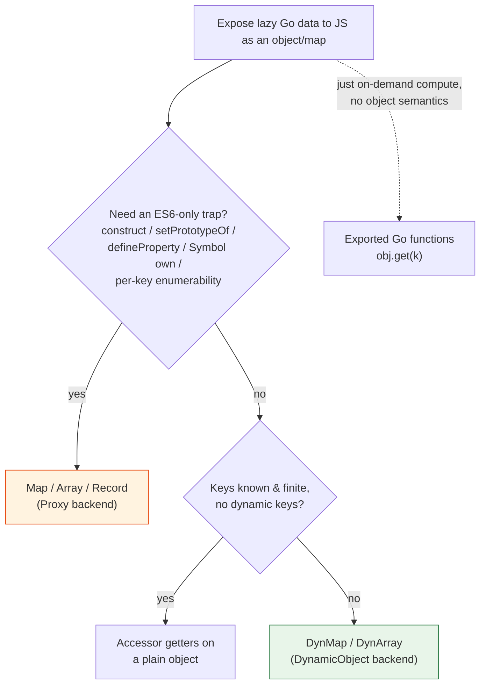

# Lazy data structures over goja — system guide for interns

> Audience: an intern who knows Go and JavaScript and has run goja scripts, but
> has not implemented a Go-backed virtual object. Everything below is anchored
> to a file you can open.

## 0. Executive summary

The `lazy` module (`go-go-goja/modules/lazy`) lets JavaScript read a Go object
that looks ordinary — `device.wifis`, `rows[1_000_000]`, `env.HOME` — but whose
values are produced *on demand* by Go, only at the moment they are read. A
Wi-Fi scan runs only when JS reads `device.wifis`; an "infinite" array computes
element *i* only when JS indexes it.

It does this with **two interchangeable backends**:

- **`Map` / `Array` / `Record`** — backed by an ES6 **`Proxy`** (`vm.NewProxy`).
  Full trap matrix; needed only when an ES6-only trap is required.
- **`DynMap` / `DynArray`** — backed by a goja **`DynamicObject`**
  (`vm.NewDynamicObject`). Simpler, cheaper, and the recommended default.

The defining engineering result, measured across five samples:

| operation (100-key map) | Proxy backend | DynamicObject backend | winner |
| --- | ---: | ---: | --- |
| single cached read | 234 ns / 2 allocs | 155 ns / 1 alloc | DynamicObject 1.5× |
| `Object.keys` | 141,129 ns / 1033 allocs | 4,996 ns / 108 allocs | **DynamicObject 28×** |

Both backends are equally *lazy*: enumeration calls the Go provider **0 times**
in both. They differ in the *machinery* cost of enumeration, which the Proxy
pays per key and the DynamicObject does not pay at all.

**The rule:** use `DynMap`/`DynArray` unless you need an ES6-only trap
(`construct`, prototype interception, `defineProperty`, `Symbol` own properties,
per-key enumerability control). Use `Map`/`Array` (Proxy) only then.

---

## 1. Background you need first

### 1.1 goja and the interop boundary

goja is a pure-Go ECMAScript interpreter. There is no JIT. Source is parsed,
compiled to bytecode, and executed by a stack machine in `goja/vm.go`.
JavaScript never touches Go memory directly. Every property read, every
function call, crosses a bridging layer that translates between goja's internal
`Value` representation and ordinary Go.

A JavaScript value, from Go's side, is anything satisfying the `Value`
interface (`goja/value.go`). A Go `int` is not a JS value; `vm.ToValue(42)`
converts it. A Go `*Struct` is not a JS value either; it must be wrapped in an
object that satisfies goja's internal `objectImpl` interface. Different ways of
exposing Go are different `objectImpl` implementations with different dispatch
paths and different allocation behaviour.

### 1.2 What "lazy" means here

Laziness means *defer the work until it is needed*. The moments "needed" happens
are exactly the operations JS performs on the object: a read, an `in` test, an
enumeration, a serialisation. A lazy object intercepts those moments and does
Go work in response to a *specific* operation — never more, never less.

The crucial distinction this module is built around:

- **Operations that list keys** (`Object.keys`, `for...in`, `in`) should do **no**
  provider work. Listing the keys of a device must not scan Wi-Fi.
- **Operations that read values** (`obj.k`, `JSON.stringify`, spread) do call the
  provider, because their semantics are defined in terms of the values.

The module's job is to make that distinction hold, and the benchmark's job is to
prove it does.

---

## 2. The mechanism space

goja offers several ways to expose Go data to JS. Only some can be lazy.

| Mechanism | Lazy reads? | Free enumeration? | Object-like? | Notes |
| --- | --- | --- | --- | --- |
| **ES6 `Proxy`** | yes (Get trap) | yes, via per-key descriptor machinery | yes | full trap matrix + invariants |
| **`DynamicObject`** | yes (Get) | **yes — 0 Get calls** | yes | goja-native virtual object; no invariants |
| **Accessor getters** | yes (getter) | yes (0 getter calls, JS spec) | yes | known finite keys only |
| Go `map[string]any` | no (no read hook) | n/a (eager) | yes | *live* view, not on-demand |
| Reflect struct | no (direct reflect) | n/a | yes | fields read by reflection |
| Function-call API | yes | n/a | **no** (`obj.get("k")`) | simplest; not object-like |

The module implements the first two as first-class backends and documents the
third (accessor getters) for the known-keys case. The last three are not lazy in
the interceptor sense and are out of scope.

---

## 3. The Proxy backend (`Map` / `Array` / `Record`)

> Files: `goja/proxy.go`, `goja/builtin_proxy.go`; `modules/lazy/lazy.go`.

### 3.1 The trap model

A Proxy wraps a **target** object and routes operations through a **handler** of
trap functions. goja exposes the handler as a Go struct,
`goja.ProxyTrapConfig` (`goja/builtin_proxy.go`), with one optional function
field per trap. A `nil` field means "no trap; fall through to the target".

```go
p := vm.NewProxy(target, &goja.ProxyTrapConfig{
    Get:                      func(t *goja.Object, p string, r goja.Value) goja.Value { ... },
    Has:                      func(t *goja.Object, p string) bool { ... },
    GetOwnPropertyDescriptor: func(t *goja.Object, p string) goja.PropertyDescriptor { ... },
    OwnKeys:                  func(t *goja.Object) *goja.Object { ... },
})
```

There are 13 traps total (including `Apply`, `Construct`, `GetPrototypeOf`,
`IsExtensible`, …). For a read-only lazy object, the module installs the four
above plus (optionally) `Set`/`DeleteProperty` for mutable stores.

A `Proxy` is a `goja.Value`: it implements the unexported `valueContainer`
interface (`toValue(*Runtime) Value`, `goja/value.go:97`), so `vm.Set`,
`vm.ToValue`, and function returns all accept it. `Proxy.Revoke()` nulls the
handler so further JS operations throw.

### 3.2 The four parts of a lazy Proxy

Every lazy structure is built from four decisions:

1. **The target** — what the Proxy wraps; controls the invariants. The module
   uses a fresh, empty, **extensible** `vm.NewObject()` (or `vm.NewArray()` for
   `Array`). An empty extensible target has no own properties, so no trap result
   can violate an invariant.
2. **The provider** — `func(key string) any` (maps) or `func(i int) any`
   (arrays). May block (a real scan). Returns `nil` for "absent".
3. **The cache** — memoises the converted `goja.Value` (not the raw Go value),
   keyed per runtime. Preserves identity (`obj.k === obj.k`) and runs `ToValue`
   once per key.
4. **The traps** — `Get` (the lazy read path), `Has`/`OwnKeys` (cheap, never
   call the provider), `GetOwnPropertyDescriptor` (the sharp edge, see §3.4).

### 3.3 How JS operations reach the traps

```
device.wifis        -> [[Get]]("wifis")              -> Get trap
"wifis" in device   -> [[HasProperty]]("wifis")     -> Has trap
Object.keys(device) -> [[OwnPropertyKeys]]          -> OwnKeys trap
                   then per key: [[GetOwnProperty]] -> GetOwnPropertyDescriptor trap
JSON.stringify      -> [[Get]]("toJSON") then [[Get]](key) per enumerable key
```

### 3.4 The enumeration sharp edge (read this twice)

`Object.keys` and `for...in` do **not** stop at `ownKeys`. After getting the key
list, the engine calls `[[GetOwnProperty]]` for *each* key to test
enumerability. In goja, `proxyObject.keys()` (`goja/proxy.go`) does:

```
for key in ownKeys-result:
    prop = proxy.getOwnProp(key)        # invokes GetOwnPropertyDescriptor trap
    if prop == nil or undefined: skip
    if valueProperty and not enumerable: skip
    keep(key)
```

So a `GetOwnPropertyDescriptor` trap that *builds the value* (calls the
provider) materialises the entire object on enumeration. Measured (phase4):
enumerating a 4-key device called the provider for every non-cached key.

### 3.5 The fix: flag-only descriptors

Return a descriptor that carries **only flags**, never a value:

```go
// modules/lazy/lazy.go
func flagOnlyDescriptor(enumerable bool) goja.PropertyDescriptor {
    return goja.PropertyDescriptor{
        Enumerable:   goja.ToFlag(enumerable),
        Configurable: goja.FLAG_TRUE,
        // Value and Writable intentionally left unset
    }
}
```

After this, `Object.keys` and `for..in` call the provider **0 times** (measured),
while reads still work and `JSON.stringify` still materialises visited values.

### 3.6 Why the flag-only descriptor survives (goja internals)

This is subtle; a small change silently breaks `Object.keys` (keys vanish).

1. The trap returns `PropertyDescriptor{Enumerable: TRUE, Configurable: TRUE}` (no `Value`, no `Writable`).
2. `nativeProxyHandler` calls `desc.toValue(r)` (`goja/object.go:85`) → builds a JS descriptor `{enumerable, configurable}`.
3. `proxyGetOwnPropertyDescriptor` calls `complete()` (`goja/object.go:124`), which fills gaps: `Value=undefined`, `Writable=FLAG_FALSE`; `Enumerable` stays `TRUE`.
4. Final branch (`goja/proxy.go`):
   ```
   if Writable==TRUE && Configurable==TRUE && Enumerable==TRUE { return Value }   // fast path
   return toValueProp(...)                                                          // slow path
   ```
   Because `Writable` is `FLAG_FALSE`, the **fast path does not run**; `toValueProp` (`goja/builtin_object.go:114`) builds a `valueProperty` with `enumerable=true`, so `keys()` keeps the key.
5. Had `Writable` defaulted to `TRUE`, the fast path would `return Value` (undefined), and `keys()` treats undefined as "absent" → **the key vanishes from `Object.keys`**.

> **Rule:** set `Configurable: FLAG_TRUE`, set `Enumerable` explicitly, and
> **leave `Writable` unset**. Use the `flagOnlyDescriptor` helper; never
> hand-roll the descriptor.

### 3.7 Proxy invariants

Proxy traps are validated against the target (`goja/proxy.go`):
- `ownKeys` must include every non-configurable target property.
- On a non-extensible target, `ownKeys` may not add keys.
- `get`/`set`/`getOwnPropertyDescriptor` must be compatible with non-configurable target properties.

A fresh empty extensible target satisfies all of these vacuously. **Exception:**
an `Array` target owns a non-configurable `length`; the `Array` type therefore
does *not* install `GetOwnPropertyDescriptor`/`OwnKeys` and surfaces indices only
through `Get`/`GetIdx`/`HasIdx` (see §5.2).

---

## 4. The DynamicObject backend (`DynMap` / `DynArray`)

> Files: `goja/object_dynamic.go`; `modules/lazy/dyn.go`.

### 4.1 The interface

goja's `DynamicObject` is a 5-method Go interface:

```go
// goja/object_dynamic.go:19
type DynamicObject interface {
    Get(key string) Value      // nil = absent (delegates to prototype)
    Set(key string, val Value) bool
    Has(key string) bool
    Delete(key string) bool
    Keys() []string
}
```

`vm.NewDynamicObject(d)` wraps it as a JS object. Its documented contract
(`goja/object_dynamic.go:99`): all properties are writable/enumerable/configurable;
the object is always extensible; **there are no invariant checks and no target**.
goja's own comment: *"similar to ECMAScript Proxy … a lot more efficient."*

### 4.2 Why it is cheaper and simpler

- **No `GetOwnPropertyDescriptor`.** Enumeration uses `Keys()` alone and never
  calls `Get` (verified: `Object.keys` → 0 Get calls). The §3.4 sharp edge does
  not exist here; there is no flag-only descriptor to get right.
- **No invariant checks, no target.** One fewer allocation per read (1 vs 2).
- **Automatic prototype delegation.** `Get` returning `nil` means "absent", and
  goja falls through to the prototype. The Proxy needed a manual `t.Get(p)`
  fallthrough in its `Get` trap; the DynamicObject does not.

### 4.3 Implementation

```go
// modules/lazy/dyn.go
type DynMap struct {
    Keys     []string
    Provider func(key string) any
    Mutable  bool
}

type dynMapHandler struct {
    m     *DynMap
    vm    *goja.Runtime
    cache map[string]goja.Value
}

func (h *dynMapHandler) Get(key string) goja.Value {
    if !containsString(h.m.Keys, key) { return nil }   // nil -> prototype
    return lazyGetStr(h.vm, h.cache, h.m.Provider, key)
}
func (h *dynMapHandler) Has(key string) bool  { return containsString(h.m.Keys, key) }
func (h *dynMapHandler) Keys() []string        { return h.m.Keys }
```

Read-only enforcement: the `DynamicObject` interface requires `Set`/`Delete`,
so a non-mutable `DynMap` wraps the handler in `readOnlyDynMap` whose `Set`/`Delete`
return `false` (goja treats a `false` return as a rejected write).

### 4.4 Limitations of the DynamicObject

- No ES6-only traps: `construct`, `getPrototypeOf`/`setPrototypeOf`
  interception, `defineProperty` interception.
- No own `Symbol` properties (but a prototype with `Symbol.iterator` can be set
  — see `object_dynamic.go` docs / `TestDynamicObjectCustomProto`).
- No per-key enumerability control: every key from `Keys()` is enumerable.
- All properties are configurable/writable by contract; you cannot model a
  frozen property.

---

## 5. The three concrete types (and one Array caveat)

### 5.1 `Map` / `DynMap` — string-keyed, keys known up front

`Keys` drives `OwnKeys`/`Keys()`; `Provider` produces each value on demand.
`Mutable` installs `Set`/`DeleteProperty` (Proxy) or uses the handler's
`Set`/`Delete` (DynamicObject). Use this for a device descriptor, a config
object, any record with a known field set.

### 5.2 `Array` — integer-indexed with a length (Proxy only, with a caveat)

`Array` uses an Array target so `Array.isArray(proxy)` is true. It installs only
`Get`, `GetIdx`, `HasIdx` — **not** `GetOwnPropertyDescriptor`/`OwnKeys` —
because an Array target owns a non-configurable `length` and returning an absent
descriptor for it would panic (the invariant). `length` is handled in the `Get`
trap. Consequence: `i in arr` is `true` but `Object.getOwnPropertyDescriptor(arr, i)`
is `undefined` (indices are not own). `for...of` works via the inherited
`Array.prototype[Symbol.iterator]`, which reads `length` and indexes lazily.

`DynArray` (DynamicArray) has the same shape and the same indexing model; its
`length` comes from `Len()`.

### 5.3 `Record` — dynamic key set (Proxy only)

For objects whose key set is itself produced on demand (env vars, a live
registry): `Keys func() []string` (cheap listing) drives `OwnKeys`; `Provider`
fetches a single value. An optional `Has func(string) bool` gives O(1)
membership. Mutable writes track an internal `extra` set unioned with `Keys()`.

---

## 6. The decision framework



- **Default to `DynMap`/`DynArray`.** Faster on every operation, simpler, no
  sharp edge.
- **Use `Map`/`Array`/`Record` (Proxy)** only when an ES6-only trap is genuinely
  required.
- **Accessor getters** when the key set is known and finite and you want the
  cheapest possible enumeration (a plain object's) with lazy reads.
- **Exported functions** when you do not need object semantics at all.

---

## 7. Measured performance (the evidence)

All numbers are 5-sample, 1s runs on an i7-1165G7, goja local fork, go1.26.

### 7.1 Backend head-to-head (phase5)

| operation | Proxy | DynamicObject | advantage |
| --- | ---: | ---: | --- |
| single cached read | 234 ns / 2 allocs | 155 ns / 1 alloc | 1.51× |
| `Object.keys` (100 keys) | 141,129 ns / 1033 allocs | 4,996 ns / 108 allocs | **28.2×** |
| `Object.keys` N=1000 | ~3.99 ms (phase4) | 50 µs | ~80× |

### 7.2 The laziness signal: `provider/op`

`provider/op` is a deterministic code-path invariant (identical across all
samples), reported via `b.ReportMetric`. It is the proof of laziness:

| operation | provider/op | meaning |
| --- | ---: | --- |
| `Object.keys` (flag-only / DynamicObject) | 0 | enumeration does not read values |
| `for...in` | 0 | same |
| `in` (Has) | 0 | membership is cheap |
| cached read | 0 | steady-state hot path |
| cold read (no cache) | 1 | first read materialises |
| naive materialising enumeration | 100 | the sharp edge |
| `JSON.stringify` (no cache) | 101 | serialisation reads every value |

### 7.3 The nuance

Lazy enumeration is **not** faster than eager in absolute terms for the *Proxy*
(15.8× an eager object, because of per-key descriptor construction). The
DynamicObject erases that gap — its enumeration is even cheaper than an eager
object's. The flag-only descriptor wins on the dimension that matters: it does
**zero** provider work, where a naive descriptor does **N**. When the provider
is a Wi-Fi scan, that is the difference between listing keys instantly and
scanning N times.

---

## 8. API reference

### 8.1 goja Proxy (`goja/builtin_proxy.go`)

| API | Where | Purpose |
| --- | --- | --- |
| `Runtime.NewProxy(target, *ProxyTrapConfig) Proxy` | `builtin_proxy.go:351` | create a Proxy from a target + Go trap config |
| `ProxyTrapConfig` | `builtin_proxy.go` | one optional Go func per ES trap (Get/Has/…/Construct) |
| `Proxy` (Go type) | `proxy.go:8` | opaque wrapper; `valueContainer`; `.Revoke()` |
| `proxyHandler` (internal) | `proxy.go:88` | the low-level trap interface (advanced) |

### 8.2 goja DynamicObject (`goja/object_dynamic.go`)

| API | Where | Purpose |
| --- | --- | --- |
| `DynamicObject` interface | `object_dynamic.go:19` | Get/Set/Has/Delete/Keys |
| `Runtime.NewDynamicObject(DynamicObject) *Object` | `object_dynamic.go:99` | create a dynamic object |
| `DynamicArray` interface | `object_dynamic.go:49` | Len/Get/Set/SetLen |
| `Runtime.NewDynamicArray(DynamicArray) *Object` | `object_dynamic.go:138` | create a dynamic array |

### 8.3 Descriptors & flags

| API | Where | Purpose |
| --- | --- | --- |
| `PropertyDescriptor` | `goja/object.go:58` | Value + Writable/Configurable/Enumerable + Getter/Setter |
| `Flag` (`FLAG_NOT_SET`/`FALSE`/`TRUE`) | `goja/runtime.go:157` | tri-state for descriptor attributes |
| `Runtime.ToFlag(bool) Flag` | `goja/runtime.go:169` | bool → Flag |

### 8.4 The `lazy` module (`modules/lazy/`)

| Type | File | Backend | Traps/Methods |
| --- | --- | --- | --- |
| `lazy.Map` | `lazy.go` | Proxy | Get, Has, OwnKeys, GetOwnPropertyDescriptor (+Set,Delete) |
| `lazy.Array` | `lazy.go` | Proxy (Array target) | Get, GetIdx, HasIdx |
| `lazy.Record` | `lazy.go` | Proxy | Get, Has, OwnKeys, GetOwnPropertyDescriptor (+Set,Delete) |
| `lazy.DynMap` | `dyn.go` | DynamicObject | Get/Set/Has/Delete/Keys |
| `lazy.DynArray` | `dyn.go` | DynamicArray | Len/Get/Set/SetLen |

Each type has `ToValue(vm *goja.Runtime) goja.Value`. `Map`/`DynMap` carry
`Keys []string`, `Provider func(key string) any`, `Mutable bool`.

The JS surface is `require("lazy")` with builders `lazy.map`, `lazy.array`,
`lazy.record` (module.go), plus a `TypeScriptDeclarer` (typescript.go).

---

## 9. File reference

| What | Where |
| --- | --- |
| Proxy creation + trap config | `goja/builtin_proxy.go` (`ProxyTrapConfig`, `NewProxy`) |
| Proxy behaviour + invariants | `goja/proxy.go` (`proxyObject`, `proxyHandler`) |
| Why flag-only descriptors stay enumerable | `goja/builtin_object.go:114` (`toValueProp`) + `goja/proxy.go` `keys()` |
| `PropertyDescriptor` / `complete` / `toValue` | `goja/object.go:58 / :124 / :85` |
| DynamicObject interface + constructor | `goja/object_dynamic.go:19 / :99` |
| `lazy` Proxy types + `flagOnlyDescriptor` | `modules/lazy/lazy.go` |
| `lazy` DynamicObject types | `modules/lazy/dyn.go` |
| `require("lazy")` builders | `modules/lazy/module.go` |
| Default-registry registration | `pkg/engine/runtime.go` (blank import) |
| Benchmarks (Proxy) | `perf/goja/phase4_lazy_bench_test.go` |
| Benchmarks (Proxy vs DynamicObject) | `perf/goja/phase5_lazy_dyn_bench_test.go` |
| HTML report (5 figures) | `GOJA-LAZY-BENCH/various/06-lazy-report.html` |

---

## 10. Implementation walkthrough — adding a new lazy type

Suppose you want a `LazyRange` — an object exposing `min`, `max`, and a lazy
`samples` array. Steps:

1. **Pick the backend.** No ES6-only trap needed → DynamicObject.
2. **Define the type and handler:**
   ```go
   type Range struct { Min, Max int; N int }
   type rangeHandler struct { r *Range; vm *goja.Runtime; cache map[string]goja.Value }
   func (h *rangeHandler) Get(key string) goja.Value {
       switch key {
       case "min": return h.vm.ToValue(h.r.Min)
       case "max": return h.vm.ToValue(h.r.Max)
       }
       return nil
   }
   func (h *rangeHandler) Has(string) bool { return true }
   func (h *rangeHandler) Keys() []string { return []string{"min","max"} }
   ```
3. **`ToValue`:** `return vm.NewDynamicObject(&rangeHandler{...})`.
4. **Test laziness** with a counting provider: assert `Object.keys` → 0 calls,
   a read → 1 call, a second read → 0 (cache).
5. **Register** if it should be `require`-able (add a builder in `module.go`).
6. **Lint + test:** `go test ./modules/lazy/ -count=1`; `golangci-lint run ./modules/lazy/...`.

The contract to hold: **`Has`, `Keys`/`OwnKeys`, and `GetOwnPropertyDescriptor`
must not call the provider. Only `Get` materialises values.**

---

## 11. Testing strategy

- **Laziness via a counting provider.** Record which keys the provider was
  asked for; assert enumeration (`Object.keys`, `for..in`) and `in` log **0**,
  a read logs **1**, a second read logs **0** (cache).
- **Identity:** `assert(obj.k === obj.k)` (cache returns the same `*Object`).
- **The §3.6 regression:** `TestMap_EnumerationIsFree` asserts `Object.keys`
  length equals the declared key count and the provider is called 0 times. This
  fails loudly if a goja upgrade flips the `Writable` default into the fast path.
- **Cross-runtime:** a cached `goja.Value` used in another runtime panics
  (`Illegal runtime transition`); construct a fresh proxy per runtime.
- **Run:** `cd go-go-goja && go test ./modules/lazy/ -count=1`;
  `go test ./perf/goja -run '^$' -bench Lazy -benchtime=1s -count=5 -benchmem`.

---

## 12. Risks, alternatives, open questions

- **Silent key-drop on goja upgrade** (§3.6): guarded by `flagOnlyDescriptor`
  and the regression test.
- **Cross-runtime panics:** build per-runtime; never share a cache/proxy.
- **Blocking providers freeze JS:** a slow scan stalls the runtime. Do
  background work in Go; block JS only on the result. (Async providers were
  descoped for this module.)
- **`JSON.stringify` is inherently materialising:** unavoidable; install a
  `toJSON` trap or read specific keys for large objects.
- **Should `Map` default to the DynamicObject backend internally?** Open. Today
  both are offered; the guide recommends `DynMap` unless an ES6-only trap is
  needed.
- **Infinite-stream type** (pull-based `Symbol.iterator`): future work.
  `DynamicObject` cannot own `Symbol` properties, but a prototype with
  `Symbol.iterator` can be set.

---

## 13. Glossary

- **Trap.** A function the Proxy/DynamicObject calls to intercept one internal
  object operation.
- **Target.** The object a Proxy wraps; invariants are checked against it.
  (DynamicObject has no target.)
- **Provider.** Your Go func that produces a value for a key/index on demand.
- **`Flag`.** goja's tri-state for descriptor attributes: `FLAG_NOT_SET`,
  `FLAG_FALSE`, `FLAG_TRUE` (`goja/runtime.go:157`).
- **Fall-through.** A `nil` trap (Proxy) or `nil` return (DynamicObject `Get`)
  delegates to the target/prototype unchanged.
- **Materialise.** To actually compute/convert a lazy value into a concrete
  `goja.Value`.
- **`provider/op`.** A custom benchmark metric: provider calls per operation.
  Deterministic invariant; the proof of laziness.
